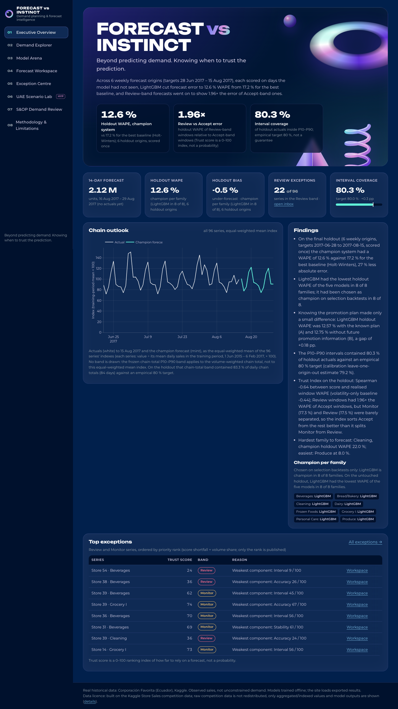
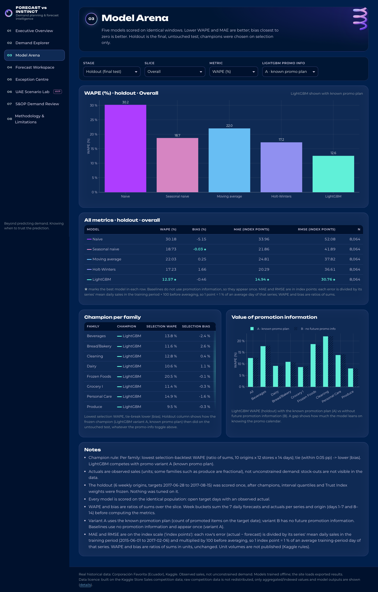
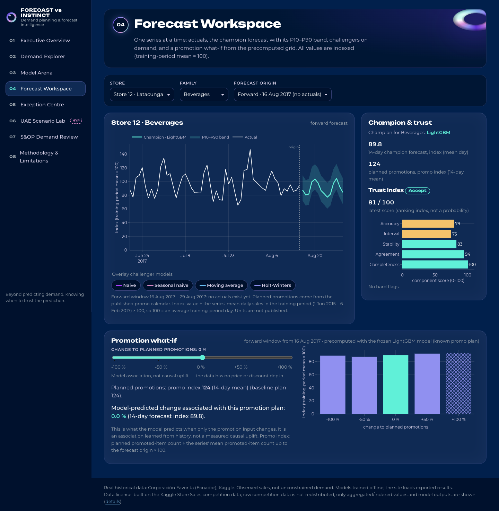
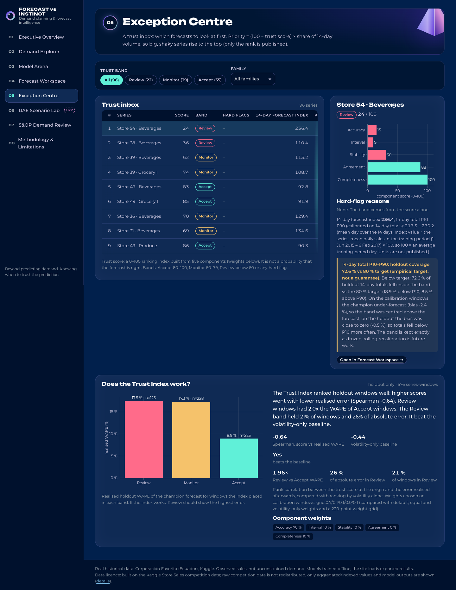
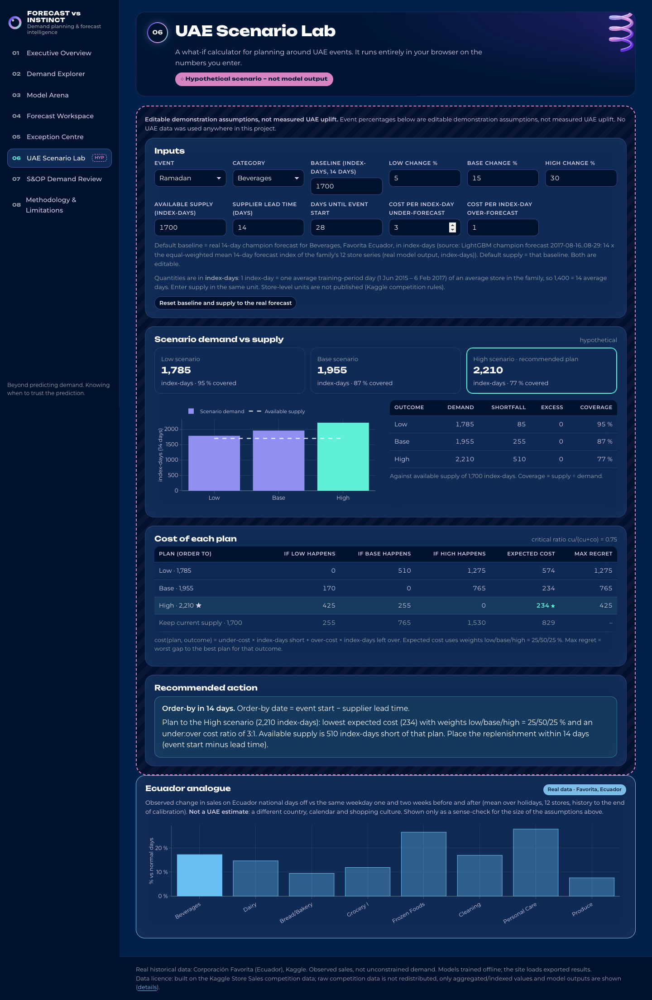
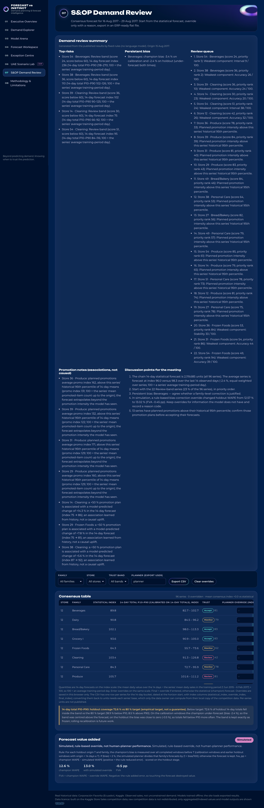
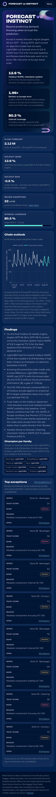
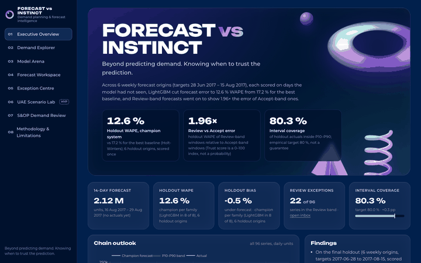
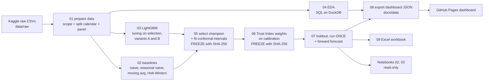

# Forecast vs Instinct

**Live dashboard: https://akashgajjar07-hue.github.io/forecast-vs-instinct/**

### AI-Powered FMCG Demand Planning & Forecast Intelligence

*Beyond predicting demand. Knowing when to trust the prediction.*

[](https://github.com/akashgajjar07-hue/forecast-vs-instinct/actions/workflows/ci.yml)


-lightgrey)


**Live dashboard:** https://akashgajjar07-hue.github.io/forecast-vs-instinct/
**Repository:** https://github.com/akashgajjar07-hue/forecast-vs-instinct

A 14-day demand forecasting and planning project on **real grocery data from Corporación Favorita (Ecuador)**: 12 stores × 8 product families = 96 daily series. It compares four classic forecasting methods with a LightGBM model, puts an honest 80 % prediction interval around every forecast, and adds a **Forecast Trust Index** that tells a planner which forecasts to accept and which to review. Every result was tested on a final holdout that was scored once, after all choices had been frozen.

> **Read this first.** The data is Ecuadorian, not UAE. Recorded sales are **observed sales, not unconstrained demand**: there is no stock-out data, so a day with empty shelves looks like a day of low demand. Every accuracy number below should be read with that in mind.

---

## Contents

1. [The problem: should you trust the forecast?](#the-problem-should-you-trust-the-forecast)
2. [Scope](#scope)
3. [Six business questions, answered with real numbers](#six-business-questions-answered-with-real-numbers)
4. [Headline findings](#headline-findings)
5. [Screenshots](#screenshots)
6. [How it works](#how-it-works)
7. [How to reproduce](#how-to-reproduce)
8. [Repository map](#repository-map)
9. [Limitations (summary)](#limitations-summary)
10. [About the author](#about-the-author)
11. [Citation and licence](#citation-and-licence)

## Data licence

Built on the Kaggle Store Sales – Time Series Forecasting competition data (Corporación Favorita). Raw competition data is not redistributed; the site shows only aggregated/indexed values and model outputs. Reproduce by downloading the data from Kaggle after accepting the competition rules.

Every per-series value (one store × one family) on the dashboard, in the S&OP export and in the planner workbook is an
**index**: value ÷ the series' mean daily sales on open days in the training period before the first selection origin
(2015-06-01 to 2017-02-06) × 100, so 100 = an average training-period day. Planned promotions are a promo index
(count ÷ the series' mean promoted-item count up to the forecast origin × 100). Family and chain series (the
Demand Explorer weekly lines, the chain outlook) are **equal-weighted** means of their member series' indexes, so
every store counts the same and no volumes can be recovered from them; family error metrics are percentages or on the
index scale. The bases are never published. The only unit values are **portfolio totals over all 96 series** (the
chain 14-day forecast, portfolio MAE / RMSE / band width). See
[`docs/data_contract.md`](docs/data_contract.md) and [`docs/agent_notes/compliance.md`](docs/agent_notes/compliance.md).

---

## The problem: should you trust the forecast?

Every week a demand planner gets a statistical forecast for hundreds of store × product combinations. They do not have time to check them all. So they face two questions:

1. **Is the forecast good enough to use?** Is a machine-learning model really better than the simple methods planners already trust, such as "same as last week"?
2. **Which forecasts should I look at myself?** If 80 out of 96 forecasts are fine, the planner should spend their time on the other 16. But which 16?

Most forecasting projects answer the first question and stop. This project tries to answer the second one too: how confident should we be in each forecast, and does that confidence turn out to be justified?

## Scope

| Item | Choice | Why |
|---|---|---|
| Data | Kaggle *Store Sales – Time Series Forecasting* (Corporación Favorita, Ecuador) | Real daily sales with promotions, holidays and store attributes |
| Stores | 12 of 54: stores 12, 14, 27, 29, 31, 36, 38, 39, 49, 51, 53, 54 | Chosen by a fixed rule using only data before the first test origin. Store type quota A2/B2/C3/D3/E2, then prefer a new cluster, then a new city, then volume nearest the type median. The result covers 11 cities and 10 clusters: representative, not just the biggest stores |
| Families | BEVERAGES, DAIRY, BREAD/BAKERY, GROCERY I, FROZEN FOODS, CLEANING, PERSONAL CARE, PRODUCE | Core FMCG and grocery categories with different behaviour: stable staples, fresh food, a highly seasonal family (frozen) and promotion-heavy categories |
| Series | 12 × 8 = **96 daily series** | Small enough to inspect by hand, big enough to compare models fairly |
| Horizon | 14 days ahead, from weekly (Tuesday) forecast origins | A typical replenishment and S&OP review window |
| Modelling window | 2015-06-01 to 2017-08-15 | PRODUCE has a recording gap before June 2015 (see [METHODOLOGY.md](METHODOLOGY.md)) |

Stores were excluded if they opened too late, had unexplained closures, or had zero-sales days in the 8 families. The full rule and the excluded stores are in `config/scope.json`.

---

## Six business questions, answered with real numbers

All accuracy numbers are on the **final holdout**: 6 weekly origins from 2017-06-27 to 2017-08-01, forecasting 2017-06-28 to 2017-08-15, scored once. Each model is scored on the same 8,064 rows (6 origins × 96 series × 14 days, open days only). WAPE = total absolute error ÷ total actual sales (lower is better). Bias = total (forecast − actual) ÷ total actual (positive = over-forecast). Sales are observed sales, not unconstrained demand.

### Q1. How well can we forecast 14 days ahead, and does ML beat simple methods?

**Yes, clearly, on average.** LightGBM with the known promotion plan had a holdout WAPE of **12.57 %**, against **17.23 %** for the best simple method (Holt-Winters). That is 4.66 percentage points lower, or 27 % less mis-forecast volume.

| Model | Holdout WAPE % | Bias % | MAE (units) | RMSE (units) |
|---|---|---|---|---|
| **LightGBM A** (known promo plan) | **12.57** | −0.46 | 208.5 | 512.5 |
| LightGBM B (no future promo info) | 12.75 | −0.80 | 211.5 | 508.1 |
| Holt-Winters (weekly seasonality, no trend) | 17.23 | +1.66 | 285.8 | 606.7 |
| Seasonal naive (same weekday last week) | 18.73 | −0.03 | 310.6 | 701.5 |
| Moving average (28 days) | 22.03 | +0.25 | 365.5 | 694.7 |
| Naive (repeat the last day) | 30.18 | −5.15 | 500.6 | 938.2 |

*Source: `outputs/holdout_results.json`.*

LightGBM was chosen as the champion in all 8 families on the earlier selection backtests, before the holdout was touched, and it then had the lowest holdout WAPE in all 8 families too. The holdout result (12.57 %) was close to the selection result (11.88 %) and the calibration result (12.65 %), so the model did not collapse on unseen data.

### Q2. Where does each approach win?

The ML model wins **on average**, but not everywhere. This is the honest picture:

| Slice | What happened on the holdout |
|---|---|
| **Families** | LightGBM best in 8 of 8. Big margins in PERSONAL CARE (13.88 % vs 23.27 % for Holt-Winters), CLEANING (22.03 % vs 28.90 % for the moving average) and GROCERY I (8.63 % vs 15.48 %). Small margins in PRODUCE (8.04 % vs 9.22 %), BREAD/BAKERY (10.92 % vs 11.98 %) and DAIRY (9.15 % vs 10.76 %), where stable weekly patterns are already captured well by Holt-Winters |
| **Individual series** | LightGBM was best on 83 of 96 series. A simple model won 13: Holt-Winters 10, moving average 2, seasonal naive 1. The biggest loss was 54\|BEVERAGES (Holt-Winters 35.23 % vs LightGBM 40.95 %) |
| **Horizon** | LightGBM best at all 14 horizons. Its WAPE rose from 10.1 % on day 1 to an average of 13.1 % on days 8–14. The gap to Holt-Winters is narrowest on day 1 (about 1.2 pp) |
| **Weekly totals** | Summing each week's 7 days (how planners are often measured): LightGBM 7.42 % (week 1) and 9.39 % (week 2). The **moving average becomes second best** at weekly level (8.53 % / 10.67 %), so simple methods come much closer here |
| **Holiday days** | Only 176 holiday rows (one national day, 11 August, plus a few local ones). The **moving average beat LightGBM** on them: 16.41 % vs 17.13 %. A small sample, but a real warning |
| **Promo vs no-promo days** | Almost every day had some promotion (7,412 promo rows, 652 no-promo rows). LightGBM A scored 12.57 % vs 12.50 %: no meaningful difference |
| **Hardest / easiest family** | CLEANING (22.03 %) and FROZEN FOODS (18.66 %) were hardest; PRODUCE (8.04 %) and GROCERY I (8.63 %) easiest |

*Sources: `outputs/holdout_results.json`, executed `notebooks/02_forecasting_battle.ipynb` sections 8–15.*

A near-zero overall bias (−0.46 %) **hides family-level biases**: on the holdout, CLEANING was under-forecast by 6.31 % while DAIRY (+4.02 %) and FROZEN FOODS (+3.92 %) were over-forecast. The errors cancel in the total but not on the shelf.

### Q3. How much does knowing the promo plan help?

**A little, consistently, but it is not the main source of the ML advantage.** The same LightGBM model was run twice: variant A sees the planned number of promoted items on each future day (a retailer agrees its promotion calendar in advance); variant B sees only promotion history up to the forecast date.

| Stage | WAPE A (known plan) | WAPE B (no future promo) | Gain from the plan |
|---|---|---|---|
| Selection (10 origins) | 11.88 % | 12.05 % | 0.16 pp |
| Calibration (8 origins) | 12.65 % | 12.91 % | 0.26 pp |
| Holdout (6 origins) | 12.57 % | 12.75 % | 0.18 pp |

By family on the holdout, the plan helped most in GROCERY I (0.39 pp) and PERSONAL CARE (0.35 pp). Variant B was slightly better in FROZEN FOODS, BREAD/BAKERY and DAIRY.

Two important limits: `onpromotion` is only a **count of promoted items**, with no price or discount depth, and the comparison is **an association, not causal uplift**. The dashboard's promo "what-if" (scaling the plan by −100 % to +100 %) shows what the model predicts, and the model's response is not always sensible: for example, removing all promotions for store 49 GROCERY I *raises* its forecast by 7.4 %, a model artefact.

### Q4. How uncertain are the forecasts, and are the intervals honest?

Every daily forecast has an 80 % prediction interval (P10 to P90), built by **scaled split-conformal prediction**: look at how wrong the model was on 8 calibration origins, and assume the future will be wrong in a similar way.

| Check | Result |
|---|---|
| Holdout coverage (target 80 %) | **80.32 %** of actuals fell inside P10–P90 |
| Misses | 10.5 % below P10, 9.2 % above P90 (target 10 % / 10 %) |
| Honest preview before the holdout (leave-one-origin-out on calibration) | 79.20 % |
| Coverage by family | from 72.2 % (BEVERAGES) to 87.8 % (GROCERY I) |
| Coverage on Sundays (horizons 5 and 12) | 70.8 % and 67.2 %: **Sundays are under-covered** |
| Average band width | 615.6 units per series-day, 37.3 % of the forecast |
| Chain total (all 96 series, own band) | 83.3 % coverage, width 15.9 % of the forecast |
| **14-day total per series** (S&OP band, own calibration) | **72.6 %** (target 80 %): 18.9 % below P10, 8.5 % above P90; width 20.5 % of the 14-day forecast |

**So: honest overall, not honest everywhere.** The overall number is right on target, but BEVERAGES, BREAD/BAKERY and CLEANING bands were too narrow, GROCERY I, PERSONAL CARE and DAIRY bands too wide, and Sunday bands too narrow, because one quantile is shared by all seven weekdays. The intervals are empirical targets, not guarantees.

**The 14-day band in the S&OP table misses its target.** Planners order on 14-day totals, so each series also gets a band calibrated directly on its 14-day total (8 calibration origins, quantiles per family, frozen with a hash before holdout scoring). On the holdout it held **72.6 %** of 14-day totals against the 80 % target (calibration leave-one-origin-out estimate 77.3 %; by family 61.1 % (BREAD/BAKERY) to 93.1 % (PERSONAL CARE)). On the calibration windows the champion under-forecast (bias −2.4 %), so the band was centred above the forecast; on the holdout the bias was close to zero (−0.5 %), so 14-day totals fell below P10 more often. The band is kept exactly as frozen. Rolling recalibration on the most recent windows is listed as future work. It replaced the original display, the sum of 14 daily bounds, which covered 94.1 % only because it was about twice as wide (42.1 % vs 20.5 % of the forecast). That fix came from the independent review and was designed after the holdout had been opened; it was not tuned on holdout results.

### Q5. Can we tell in advance which forecasts to trust?

The **Forecast Trust Index** gives every series a 0–100 score at the forecast date, using only information known then: recent accuracy, recent interval coverage, demand stability, agreement between models and data completeness. Bands: **Accept** (80+), **Monitor** (60–79), **Review** (below 60, or any hard flag). The score is a ranking index, **not a probability**.

Weights were chosen on the calibration origins by a rule written before seeing results, frozen with a SHA-256 hash, then tested once on the holdout (576 series-windows):

| Test on the holdout | Result |
|---|---|
| Spearman rank correlation, score vs realised error (more negative = better) | **−0.637** |
| Same, for a volatility-only index (the simple baseline) | −0.442 |
| WAPE of Accept / Monitor / Review windows | 8.93 % / 17.30 % / 17.46 % |
| Review error ÷ Accept error | 1.96× |
| Review band: share of windows vs share of absolute error | 21.4 % vs 26.3 % |

**It works as a ranking, with three big caveats.**

1. **It is mostly past accuracy.** The chosen weights put 70 % on historical accuracy. On the holdout, accuracy alone ranked windows slightly *better* (−0.647) than the full index, and the score's rank correlation with the accuracy component was 0.971. In plain words: "this series was hard recently, so it will be hard again."
2. **The promotion hard flag pointed the wrong way.** It fired on 67 windows (11.6 %), which had *lower* error (8.71 %) than the others (13.02 %). 65 of the 123 Review windows were there only because of this flag, which is why Monitor and Review have almost the same error.
3. **Completeness was always 100**, so its 10 % weight just adds 10 points to every score.

The index separates **Accept from the rest** well. It does not separate Monitor from Review.

### Q6. What should a planner do this week?

The last actual date is 2017-08-15. The pipeline produces a forward forecast for 2017-08-16 to 2017-08-29 and an S&OP demand review pack from it (`docs/data/sop.json`):

- The chain 14-day statistical forecast is **2,119,685 units** (all 96 series). The average series is forecast 2.4 % below its last 14 observed days (equal-weighted over series, on the index scale).
- **22 of 96 series are in Review** (Monitor 39, Accept 35). Start there, in priority order (priority = (100 − score) × share of volume; only the rank is published).
- The top two risks are **store 54 BEVERAGES** (score 24, weakest component: interval reliability) and **store 38 BEVERAGES** (score 36, weakest component: accuracy).
- **Persistent bias:** BEVERAGES was under-forecast on both calibration (−3.4 %) and holdout (−2.4 %). Discuss whether a family-level correction is justified.
- **13 series have planned promotions above their historical 95th percentile.** Confirm those promotion plans before accepting the forecasts (and remember Q5: this flag did not predict higher error on the holdout).
- **Do not override by habit.** A simulated, rule-based bias-correction "planner" made the holdout *worse*: WAPE went from 12.57 % to 13.02 % (forecast value added −0.45 pp, 17 of 48 family-origin decisions adjusted). This is a simulation, not real planner performance, but it supports a simple rule: override only with information the model does not have, and record a reason code.

---

## Headline findings

1. **ML beats simple methods on average, by a meaningful margin.** Holdout WAPE 12.57 % vs 17.23 % for Holt-Winters. The win held in every family and every horizon, and on 83 of 96 series.
2. **Simple methods are not dead.** Holt-Winters won 10 series, the moving average won on holiday days and was second best on weekly totals.
3. **The promo calendar helps only a little** (0.16–0.26 pp WAPE across the three stages). Feature importances suggest (no ablation was run) that most of the ML gain comes from pooling 96 series and knowing the calendar (weekday, day of month, holidays) in advance.
4. **The daily 80 % intervals hit 80.3 % overall** but are too narrow on Sundays and for some families. **The 14-day-total band hit only 72.6 %** because the calibration-period bias did not persist into the holdout.
5. **The Trust Index ranks forecasts better than volatility alone** (−0.637 vs −0.442), but it is dominated by past accuracy and its promotion flag needs redesign.
6. **Near-zero total bias can hide family bias** of −6.3 % to +4.0 %.

## Screenshots

| Overview | Model Arena |
|---|---|
|  |  |

| Forecast Workspace | Exception Centre |
|---|---|
|  |  |

| UAE Scenario Lab (hypothetical) | S&OP Demand Review |
|---|---|
|  |  |

Mobile (390 px): 

Demo: 

The **UAE Scenario Lab** is a hypothetical planning calculator. Its baselines are real model forecasts for Ecuador, expressed in **index-days** (14 × the equal-weighted mean 14-day forecast index of the family's 12 series; 1,400 = 14 average training-period days for an average store), but its event percentages (Ramadan, Eid, summer and so on) are **editable demonstration assumptions, not measured UAE uplift**.

---

## How it works

Models are trained offline; the site loads exported results. The website never retrains anything.



In words:

1. **Prepare.** Build a daily panel for the 96 series. Closed days are blank (not zero). Add holiday, payday and earthquake flags.
2. **Backtest.** At each weekly origin T, every model sees only data up to T (a "masked view") and forecasts T+1 to T+14. There are 24 origins in three stages: **selection** (10 origins, pick and tune models), **calibration** (8 origins, fit intervals and Trust weights), **holdout** (6 origins, final exam).
3. **Freeze.** The champion choice, interval quantiles and Trust weights are saved and hashed. The holdout script refuses to run if any of them has changed.
4. **Holdout, once.** Score everything on the holdout and log a digest of the results.
5. **Forward.** Forecast 2017-08-16 to 2017-08-29 using the planned promotions from Kaggle's `test.csv`.
6. **Publish.** Export small JSON files for the dashboard, build the Excel workbook and the notebooks.

Full details are in [METHODOLOGY.md](METHODOLOGY.md). The model is described in [MODEL_CARD.md](MODEL_CARD.md).

## How to reproduce

You need Python 3.12, Node 22 (only for the JavaScript tests) and a Kaggle account.

```bash
git clone https://github.com/akashgajjar07-hue/forecast-vs-instinct.git
cd forecast-vs-instinct
python3.12 -m venv .venv && source .venv/bin/activate
pip install -r requirements.txt
```

**Get the data.** Accept the competition rules on Kaggle, put your Kaggle API token in `~/.kaggle/` (never commit it), then:

```bash
kaggle competitions download -c store-sales-time-series-forecasting -p data/raw
unzip data/raw/store-sales-time-series-forecasting.zip -d data/raw
```

`data/raw/` should then contain `train.csv`, `test.csv`, `stores.csv`, `oil.csv`, `holidays_events.csv`, `transactions.csv` and `sample_submission.csv`. Raw data is not included in this repository.

**Run the pipeline in order.**

| Step | Command | What it does | Approx. time* |
|---|---|---|---|
| 1 | `python scripts/01_prepare_data.py` | Split calendar, store scope, modelling panel | |
| 2 | `python scripts/02_run_baselines.py --n-jobs 4` | Four baselines on selection + calibration | about 21 s |
| 3 | `python scripts/03_tune_lightgbm.py` | LightGBM tuning grid and final A/B backtests (`--final-only` skips the grid) | about 20 min grid + 9 min final |
| 4 | `python scripts/04_build_eda.py` | SQL demand analysis → `outputs/eda/` | |
| 5 | `python scripts/05_select_and_freeze.py` | Champion per family + interval quantiles, frozen with hashes | |
| 6 | `python scripts/06_trust_calibrate.py` | Trust Index weights on calibration, frozen | |
| 7 | `python scripts/07_holdout_and_forward.py --rerun` | Holdout + forward forecast | about 4 min |
| 8 | `python scripts/08_export_dashboard.py` | Dashboard JSON → `docs/data/` | about 18 s |
| 9 | `python scripts/09_build_workbook.py` | Excel planning workbook | |
| 10 | `python scripts/build_notebooks.py --execute` | Rebuild and execute notebooks 02 and 03 | about 1 min |

\*Times measured on a MacBook Air with 4 threads; blank where not recorded.

About step 7: the holdout was run once, on 2026-11-25, and that run is logged in `outputs/holdout_run.json`. The script refuses a second ordinary run. With `--rerun` it re-scores everything and only checks that the results digest matches the logged one (it prints `REPRODUCED` or `DIGEST MISMATCH`). It never replaces the original log.

**Tests.**

```bash
pytest -m "not data"                   # CI-safe tests, no Kaggle data needed
pytest                                 # everything, including checks on the real data and outputs
node --test tests/js/scenario.test.mjs # Scenario Lab formulas (JS = Python)
```

**View the dashboard locally.** `python -m http.server -d docs 8000`, then open http://localhost:8000.

## Repository map

```
config/          scope.json (stores, families, rule), split_calendar.json (origins by stage)
data/            raw/ (Kaggle CSVs, not committed), processed/panel.parquet (not committed)
                 data_dictionary.md
docs/            the GitHub Pages dashboard (index.html, js/, data/, assets/)
                 DECISIONS.md (every judgement call), data_contract.md, agent_notes/
excel/           forecast_vs_instinct_planning_workbook.xlsx (live formulas)
notebooks/       01 demand intelligence, 02 forecasting battle, 03 trust and uncertainty
outputs/         frozen decisions (*.json + *.sha256), holdout results, EDA, tuning logs
                 backtests/*.parquet and holdout/*.parquet are regenerated, not committed
reports/         VALIDATION_REPORT.md, holdout run output
scripts/         01..09 pipeline steps, notebook builder, checks
sql/             14 DuckDB queries, one per demand question
src/             data, scope, splits, backtest harness, features, models, metrics,
                 intervals, trust, selection, freeze, scenario, export
tests/           pytest suite (+ tests/js for the scenario calculator)
METHODOLOGY.md   how everything was done, with formulas
MODEL_CARD.md    the LightGBM champion
LIMITATIONS.md   what this project cannot tell you
STUDY_GUIDE.md   concepts, a worked example and interview questions
```

## Limitations (summary)

The full list is in [LIMITATIONS.md](LIMITATIONS.md). The most important ones:

- **Observed sales, not unconstrained demand.** No stock-out data, so lost sales are invisible.
- **Family level, not SKU level**, and only 96 series from 12 stores.
- **Ecuador, not UAE.** The UAE Scenario Lab uses hypothetical, editable assumptions.
- **Promotions are a count of promoted items**, with no price or discount depth. Promotion results are associations, not causal uplift.
- **Short holdout:** 6 origins in June–August 2017. No December peak, so FROZEN FOODS' hardest season is untested.
- **The Trust Index is mostly past accuracy**, its promo flag fired on easier windows, and completeness was constant.
- **Intervals under-cover Sundays** and some families.
- **The 14-day S&OP band under-covers: 72.6 % vs 80 %** (bias shift between calibration and holdout). Kept as frozen; rolling recalibration is future work.
- **The FVA figure is a simulated rule**, not real planner performance.
- **The Excel formulas were checked by a Python evaluator**, not by Excel itself.

## About the author

**Akash Gajjar**
- MSc Supply Chain Management, University of Liverpool (2025)
- Retail operations and inventory experience at Primark and Uniqlo (Liverpool ONE)
- Looking for Demand Planning Analyst, Junior Demand Planner and Supply Chain & Inventory Analyst roles in Abu Dhabi (FMCG and grocery)
- GitHub: [akashgajjar07-hue](https://github.com/akashgajjar07-hue)
- LinkedIn: *(link to be added)*

I built this project to show how I would approach a planner's real question: not only "what will we sell?" but "how much should I trust this number, and where should I spend my review time?"

## Citation and licence

**Data:** Alexis Cook, DanB, inversion, Ryan Holbrook (2021). *Store Sales – Time Series Forecasting*. Kaggle. https://www.kaggle.com/competitions/store-sales-time-series-forecasting

The data belongs to its owners (Kaggle / Corporación Favorita) and is **not included** in this repository. Built on the Kaggle Store Sales – Time Series Forecasting competition data (Corporación Favorita). Raw competition data is not redistributed; the site shows only aggregated/indexed values and model outputs. Reproduce by downloading the data from Kaggle after accepting the competition rules. Per-series values are published only as indices with private bases (see [Data licence](#data-licence)). Please check the competition rules on Kaggle before reusing anything derived from the data.

**Code:** MIT licence, see [LICENSE](LICENSE). The vendored Plotly build in `docs/assets/vendor/` keeps its own licence (`PLOTLY_LICENSE.txt`).
